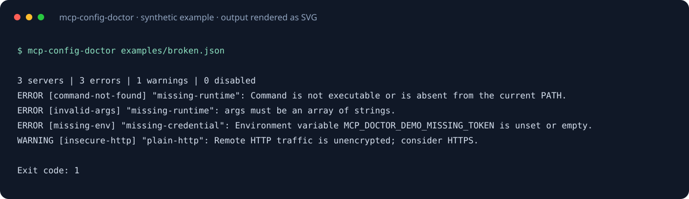

# MCP Config Doctor · MCP 配置体检

[English](README.md) · [发布包](https://github.com/Yang1107-wzy/mcp-config-doctor/releases)

启动 MCP 客户端前，先发现配置里的常见问题。支持 JSON 的 `mcpServers` 和 VS Code 风格 `servers` 根节点；整个检查在本地运行，不执行配置中的命令，也不连接服务器。



## 安装

Python 3.10+，没有运行时第三方依赖。当前通过 GitHub 发布，未发布到 PyPI。

```sh
python -m pip install "git+https://github.com/Yang1107-wzy/mcp-config-doctor.git@v1.0.0"
mcp-config-doctor --version
```

也可下载 Release 中的 wheel，以实际文件名执行 `python -m pip install 下载的文件.whl`。

## 快速体验

```sh
git clone https://github.com/Yang1107-wzy/mcp-config-doctor.git
cd mcp-config-doctor
python -m pip install .
mcp-config-doctor examples/good.json
mcp-config-doctor examples/broken.json --format json
```

好示例返回 0。坏示例返回 1，包含命令不存在、参数类型错误、环境变量缺失、远程明文 HTTP 等诊断。

## 能检查什么

- 当前 PATH 中的命令是否可执行；参数是否为字符串数组。
- 根节点、服务器、`env`、`headers` 的结构与字段类型。
- stdio 与 HTTP/SSE 的字段混用或类型冲突。
- URL 协议、主机、端口、内嵌账户密码。
- `${NAME}`、`${env:NAME}` 引用的当前进程环境变量是否存在且非空。
- 疑似凭据字段里的直接写入值、非 loopback 的 HTTP 连接。
- 重复 JSON 属性；`disabled: true` 的服务跳过检查。

`${input:NAME}` 和未知占位符语法会产生警告。URL 的已知环境引用在内存中解析后检查，不修改原配置。不同客户端支持的变量语法不同，实际 GUI 客户端的 PATH 和环境也可能与当前终端不同。

## 用于自动检查

```sh
mcp-config-doctor .mcp.json --strict --format json > mcp-report.json
```

| 退出码 | 含义 |
| --- | --- |
| 0 | 无错误；默认允许警告 |
| 1 | 检查不通过；`--strict` 也将警告视为失败 |
| 2 | 用法、文件或 JSON 解析失败 |

JSON 报告包含 `schema_version: 1`、服务器数、错误数、警告数和逐项诊断。诊断包含服务名、环境变量名，不复制参数、环境和 header 的秘密值；不要把秘密放在这些名称里。

## 边界

这是 JSON 配置预检查，不能验证协议符合性、服务器健康、OAuth、远程可用性、脚本路径、服务器专属参数或包安装。暂不支持 JSONC、TOML、自动寻找客户端配置、客户端专属 `inputs` 定义。凭据警告依据字段名，不是完整秘密扫描器。需要运行时协议调试可使用官方 [MCP Inspector](https://github.com/modelcontextprotocol/inspector)。本项目是独立实现。

## 开发

```sh
python -m pip install -e .
python -m unittest discover -s tests -v
```

提供 Linux、Windows、macOS CI、合成示例与 MIT 许可。
